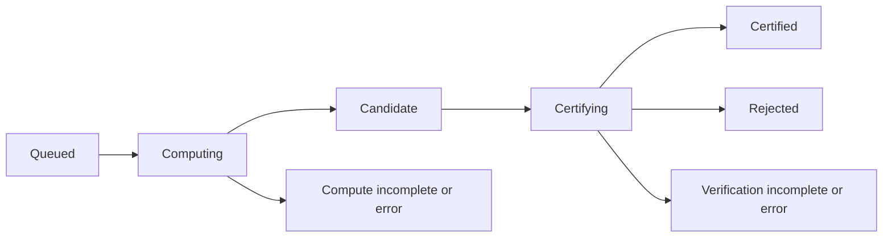

# Asynchronous computation and certification

`experiments.zipper_async_census` separates native exact computation from
independent C++ certification through a new SQLite sidecar. Workers of either
role can run concurrently. Each candidate stores its exact compressed output,
input, producer build and catalog identities, execution limits, output digest,
and compact producer metrics. Certification records its own authenticated
verifier identity and binds its verdict to the candidate payload digest. Different
authenticated verifier builds may certify different rows in the same producer
policy; each successful attempt records the full verifier binding. The total
certified count does not assert one uniform verifier binary for the campaign.

See the [worker measurements](zipper-async-performance.md) for measured role
allocations and the [census plan](zipper-census-plan.md) for the next frontier.

The existing synchronous reuse census, historical SQLite results, full
standalone execution, and optional standalone traces remain available.

## Start a bounded campaign

Use a frozen source checkout for a campaign. Package, producer, catalog and
runner identities are recorded; changing source files requires another policy
namespace and matching workers. A certifier must run in the recorded source
checkout with the authenticated producer executable still accessible.

```sh
python -m experiments.zipper_async_census init /path/to/async.sqlite3 \
  --limits '{"max_steps":250000,"max_terms":20000,"expansion_budget":1000000}'
python -m experiments.zipper_async_census enqueue /path/to/async.sqlite3 \
  --targets '{"3":6,"4":4}' --admit-max 10000
python -m experiments.zipper_async_census run /path/to/async.sqlite3 \
  --compute-workers 1 --certify-workers 2 --max-pending 128 \
  --max-pending-mib 1024 --wall-seconds 3600 --drain
python -m experiments.zipper_async_census status /path/to/async.sqlite3
```

If a database contains multiple policies, select one with `--policy KEY`.
`enqueue --targets` admits full-support nonpeelable inputs, rank three or higher,
up to each cutoff. Admission rotates through rank/length layers in batches of
64, and saves the ordinal advancement and next-layer rotation atomically with
admission. Short restarted admission commands retain that rotation. Repeating the
command continues admission without duplicating requests. `--admit-max` bounds
admission per invocation; an invocation need not admit the whole target.
The rank-two algorithm remains supported for standalone execution and explicit
requests, but rank two is excluded from census target enumeration.

To admit only the new length-nine rank-three layer, excluding previously
completed shorter layers:

```sh
python -m experiments.zipper_async_census enqueue /path/to/async.sqlite3 \
  --targets '{"3":9}' --min-length 9 --admit-max 252497
```

This layer contains exactly 252,497 full-support nonpeelable requests.
`--min-length` defaults to zero, preserving admission of all eligible shorter
layers. The minimum must be nonnegative; a minimum above a target cutoff admits
no requests for that rank. Per-layer cursors remain shared across target ranges,
so changing the minimum does not duplicate a previously admitted request.

`enqueue --words requests.json` accepts an array of `[rank, word]` pairs.
These are literal requests, evaluated directly. This pipeline does not yet
assemble ambient witnesses from primitive outputs: its certified count is the
number of completed, independently checked literal requests. A primitive target
list is a reduced computational domain, not a count of all represented words.

For separate role processes, replace `run` with `compute` and `certify`, using
the same database and policy. `--once` attempts at most one job. The wall clock
starts after each worker's session initialization; an admitted job drains after
the deadline. `--drain` permits an earlier exit once the admitted queue has
finished. A worker failure tells the other local workers to stop admission;
they finish their currently admitted calculations. Separate role processes are
not automatically stopped by another process failing.

## Durable states and recovery

The durable workflow is:



A candidate never counts as certified coverage. A verification limit refusal
preserves the candidate and is recorded as `verification_incomplete`. Transport,
source authentication and other operational exceptions are recorded as
`verification_error`. A completed replay disagreement is `rejected` with reason
`replay_mismatch`; stored-payload corruption has reason `candidate_integrity`.
Neither rejection nor an incomplete computation is certified coverage.

Expired claims are recovered on the next claim attempt. A worker whose lease
was reclaimed resumes claiming other work. A dead verifier stops its worker
after recording the current operational failure, preserving the rest of the
candidate queue. A separate heartbeat
extends leases during long calculations. Every claim has a fresh token;
committing a result requires the currently owned token and exact request.
Candidate insertion, successful compute attempt, and state change commit in
one transaction. Stale workers cannot overwrite a replacement worker's result.
Retries and their outcomes retain earlier attempt records.

```sh
python -m experiments.zipper_async_census retry /path/to/async.sqlite3 \
  --state verification_incomplete
```

Retrying under unchanged limits may succeed with a warm independent cache, but
is not guaranteed to do so. Larger limits require a new policy. Rejected
candidates are not automatically retried or overwritten.

## Backlog and trust

The candidate-count limit includes active computations, pending candidates,
active certifications, and verification refusals/errors. Certification failures
therefore cannot silently grow an unbounded compute backlog. The byte limit is
an admission watermark on retained uncertified compressed candidates; already
running computations may finish above it. The overshoot is the sum of the
outputs of those already admitted computations. It is not an RSS limit or a
hard disk quota. Certified payloads are retained and continue to consume disk.

Each producer uses its own exact native continuation cache. Persisted
provisional outputs are not fed into another producer calculation. Therefore
this first pipeline has no persistent graph of provisional dependencies to
invalidate: certification independently starts from each literal input and
uses only the verifier's own computations and caches. If persistent provisional
reuse is added later, dependency tracking and rejection propagation are required.

Independent replay of every candidate preserves the current certification
standard. Separating roles changes utilization and failure recovery; it does
not by itself reduce total replay work. The optional derivation experiment is
separate and does not promote queue candidates to certified status.

The `status` command uses a read-only SQLite connection and validates the stored
policy schema and digest. It can inspect historical source epochs without
loading their executables or modifying their databases.

## Attempt telemetry and timer scopes

New attempt JSON records add `attempt_metadata` and `timings`; existing sidecars
and historical attempt JSON require no SQL migration. Source authentication still
requires existing campaigns to use their recorded checkout; changed source or runner
requires a new policy. Boolean verifier callbacks
remain supported. The optional `verification_telemetry` callback supplies
observations after a verifier call, including refusals and operational failures.
Its data never determines acceptance. A telemetry exception is recorded as
`telemetry_error` while retaining the exact check's verdict. Candidate integrity
failures skip both verifier and telemetry callbacks.

The runner records the independent verifier's full `last_result` report and
`native_call_seconds` under `verification_telemetry`. Native work and cache
metrics therefore remain distinct from producer metrics. Each worker records
its session UUID, zero-based claimed-attempt index (including integrity failures and lost
leases), requested cache byte and entry budgets, and process-local cache lifetime. This identifies prior worker activity;
it does not assert that every later attempt has a cache hit. `--cache-entries`
sets the verifier entry budget (default 262144); producer sessions retain their
65536-entry default. `--cache-mib` sets each session's byte budget.

`compute_seconds` measures the producer call; `publication_seconds` measures
source/request/output validation, serialization, compression, SQL lock acquisition
and candidate insertion up to recording the attempt. Publication excludes the
final attempt insertion, job update and transaction commit. Certification records
`candidate_loading_seconds` (including source, lease and digest guards) and
`verification_seconds` (the verifier callback including its wrapper checks and
IPC). Legacy compute `seconds` retains its pre-publication scope; certification
`seconds` includes loading, checking, telemetry capture and final source guards,
ending before durable finalization. Compute error records retain the producer-call timer and identify whether
the failure occurred during computation, recording the returned result
(`result_recording`), or publication. Publication failures also
retain their own elapsed timer. These timers exclude session initialization
and do not sum to complete worker wall time. Attempt JSON, including full verifier
reports, consumes storage outside the compressed-candidate backlog watermark.

Worker polling uses indexed work-presence probes. A blocked drain exit retains
the `counts` diagnostic field and computes detailed counts once on that exit.

## Switching the computation policy

`python -m experiments.zipper_census_migrate DATABASE --source-policy OLD_KEY
--expected-literal-count COUNT --completed-layer RANK:LENGTH`
requires exhausted enumeration cursors for the declared closed census and
creates a new policy from the current native build with the old limits and
execution mode. Authenticate and stop the source worker process group first,
then take a SQLite backup API snapshot and run `PRAGMA integrity_check`.
Run migration from a clean, frozen checkout and record its commit and command.

The migration uses one write transaction for the new policy, queued literal
requests, and the `async_migrations` and `async_migration_coverage` tables.
Every original literal has one disposition: retain its existing certified
source evidence, or recompute it under the new policy. All old policy rows,
attempts, compressed candidates, and admission cursors remain byte-for-byte
unchanged. The manifest includes deterministic hashes and counts of each old
table. Retirement triggers reject subsequent mutations of old-policy rows,
including accidental worker restarts. An interrupted transaction rolls back;
repeating a completed migration validates its linkage and original history.
Each source can migrate to only one target. The target copies admission cursors
and rejects admission outside the original uncertified literal set; a new
census interval requires a separate policy.

Start workers with the manifest's explicit target `--policy`; do not enqueue
the original ordinal interval again. Old provisional candidates are historical
records and receive fresh computation and independent verification in the new
policy. Old certified rows retain their original producer and verifier binding.
The original total is the number of source literals. Its current certified
coverage is the retained source count plus target certified count; summing all
job counts across policies double-counts recomputed requests. Historical source
`computing` and `certifying` states describe interrupted attempts, not live work.
