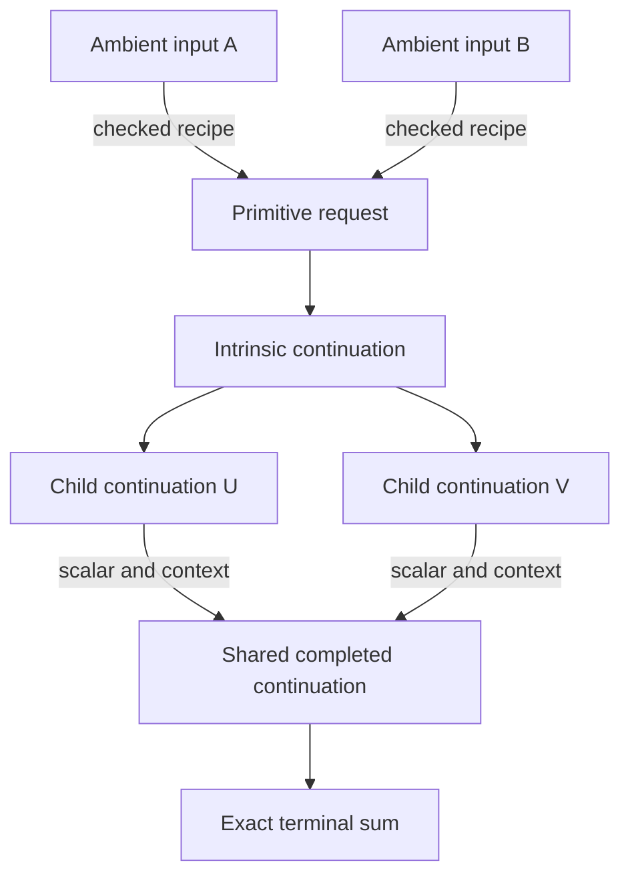
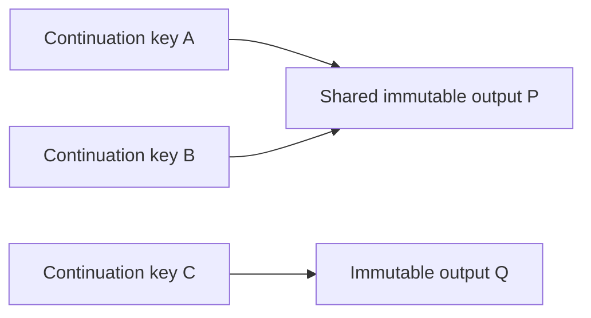

# The graph of completed continuations

The census shares completed local calculations across literal input words.
A node records all data needed to determine a continuation: its rank, phase,
local word or slider branch, processed crossings, frame, geometric boundaries,
and boundary factors. External coefficients, original endpoint names, and
already extracted outer components belong to the use of the node. They are
restored when its output is embedded into the caller.

There are two levels of sharing. Checked input reconstruction recipes refer to
primitive requests. Inside a primitive calculation, different branches can
refer to the same intrinsic continuation. Neither level imposes an unproved
braid-word identification.

This illustrates possible sharing, not a particular measured input. Each edge
retains its coefficient and context restoration. Equal full terminal terms
are collected after restoration; different endpoint records and component
orders remain different terms.

## Completed-output equality

Let \(s\) be an intrinsic continuation. Write its transition as

\[
T(s)=o_s+\sum_j a_j E_j(s_j),
\]

where \(o_s\) is the immediately completed formal sum and \(E_j\) restores
the child context and endpoint names. The transition implementation replaces
the external coefficient by one before local control, then multiplies every
child and output by the original coefficient. It is therefore linear over
\(R=\mathbb Z[q,q^{-1}]\), including in mirrored frames. Frame data stay in
the intrinsic state and do not act semilinearly on the external coefficient.

For a finite acyclic graph of completed continuations define

\[
F(s)=o_s+\sum_j a_j E_j(F(s_j)).
\]

The dependency evaluator computes this expression in postorder, collecting
coefficients exactly. Outer extraction contexts and original endpoint names
are equivariant with local transitions: they affect transportation and terminal
assembly, while all information used to select a rewrite remains in the key.

For a standalone frontier using these continuations, the quantity

\[
O+\sum_{s\text{ pending}} c_s E_s(F(s))
\]

is invariant under a transition, collection of equal states, and cancellation
of zero coefficients. Here \(O\) is the accumulated terminal output. Thus a
completed standalone execution agrees with the completed dependency evaluation
as a full formal sum, including its component records and endpoint data.

This is a completed finite-graph argument, not a new termination or complexity
bound. Cycles and resource refusals are unresolved calculations. A different
schedule can sometimes finish such an input by canceling branches earlier.
Standalone step counts, traces, and resource outcomes are not inferred from
the dependency calculation.

## Evaluation and independent checking

The native producer uses an explicit dependency stack and retains only completed
results in a bounded cache. Equal sibling continuations are collected before
descent. A hit skips the whole remaining local computation. Single-child
identity continuations share an immutable terminal sum and its size estimate.
Collected active-frame terms have a separate guard from retained cache payload.
The completion cache charges each retained key and each distinct immutable
output payload once. Several keys can refer to the same output:

The charge is the sum of key estimates plus the estimates for P and Q. Removing
the last retained reference removes that payload's charge. Temporary ownership
by an active calculation is tracked separately from cache ownership. Allocator
and JSON-container overhead are not fully represented by these estimates.
Frame-term counters do not count every transient shared result.
Neither counter is an RSS limit. Warm hits can change both transition-budget
and active-frame-term outcomes; restored outputs are still checked.

Each native implementation also memoizes its own catalog rule selection with
bounded storage. The key contains the complete environment and every selection
filter. This avoids repeating guard evaluation and introduces no additional
identification of continuation states or braid words.

The verifier also retains its own validated semilinear rule bindings. Hot
callers hold shared ownership of immutable records, so a nested lookup or cache
eviction cannot invalidate a record still in use. Every successful binding
depends on the full source identifier and the complete eligible environment,
including integer types; other environments follow the uncached validation
path. Both implementations continue to perform their own mathematical work.

The verifier uses a separately implemented intrinsic normalization, transition
engine, restoration, and collection. It builds its own completed-result cache
and compares the exact full output. It does not use a producer cache hit or
producer telemetry as evidence of correctness.

Internal completed-state caches live in memory. SQLite stores verified primitive
results and the dependencies of reconstructed ambient inputs. Stored primitive
results are independently replayed on first use in a fresh process, then
retained in a bounded set of checked payload identities. A cold verification
budget refusal is `VerifierIncomplete`; it preserves the stored leaf and makes
no new completed coverage claim. A different completed replay is a verification
error.

The original standalone API and optional traces remain available. Operational
commands, storage layout, and resource policy are described in
[the census runner documentation](zipper-census-reuse.md).
