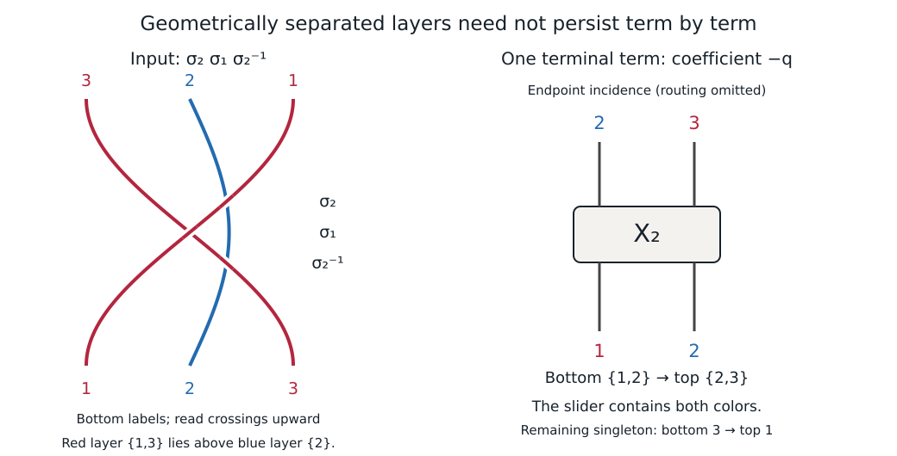

# Explicit layered input whose terminal output mixes layers

Status: explicit geometric construction plus exact verified counterexample to
termwise preservation of the original layer partition by the implemented
zipper procedure. This does not disprove the existence of a different expansion
into layer-preserving terms.

## Geometric input with fixed endpoints

Use coordinates `(x,z,u)` where u is braid time, x is the real transverse
coordinate, and z is the imaginary transverse coordinate. Original endpoints
are x=1,2,3 and z=0. Partition bottom labels as A={1,3}, B={2}.

Choose 0<delta<1/2 and 0<eta<1/2. In the interior normalized time 0<=u<=1,
set theta=pi*u and use these three strands:

    A1: x=2-cos(theta), z=2+delta*sin(theta)
    A3: x=2+cos(theta), z=2-delta*sin(theta)
    B2: x=2+eta*sin(theta), z=1.

Rescale u to [epsilon,1-epsilon]. In each endpoint collar keep x constant
and interpolate z linearly from 0 to its layer height (at the incoming end)
or from its layer height to 0 (at the outgoing end). Hence original terminal
points are fixed; this is not arbitrary endpoint motion or arbitrary
conjugation. The A strands end at each other's original x positions; B ends
at x=2. Collars have distinct constant x positions, so are disjoint.

The A strands stay in the slab |z-2|<=delta and B stays at z=1.
Delta may be arbitrarily small. The A strands never intersect: where their
x coordinates agree, their z coordinates differ by 2*delta. The A and B
strands cannot intersect because their slabs are disjoint.

This matches the intended P-layered definition in the thesis: the stated norm |b_k(t)-j*i| must be interpreted as a bound on the
imaginary coordinate. Literally the printed norm contradicts the prescribed
nonzero real coordinates by continuity at the collar. The present construction
uses thin horizontal slabs, not a dimensionally impossible planar braid.

## Exact projected braid word

Project to (u,x), with larger z over. There are exactly three transverse
crossings, since the respective equations have unique solutions:

1. A3 crosses B2 at theta1=arctan(1/eta)<pi/2. Original label3 is on the
   right and is over original label2, giving generator -2.
2. A1 crosses A3 at theta=pi/2. Their x position is2; B2 is at2+eta,
   hence this is generator1. A1 is left and over, giving +1.
3. A1 crosses B2 at theta2=pi-arctan(1/eta)>pi/2. Original label1 is
   left and over original label2, giving +2.

Thus bottom-to-top crossing order is (-2,1,2). The interpreter reads its
input right to left, so the literal input is (2,1,-2), i.e.
sigma_2 sigma_1 sigma_2^{-1}. Every cross-layer projected crossing has
A over B; the only braiding inside A is its positive two-strand crossing.
The largest bottom label3 lies in the upper layer A, so this example does not
rely merely on starting the algorithm in the lower of two layers.

## Exact implemented output obstruction

The calculation completes in37 logical transitions and has five collected
terminal terms. Exactly one term has an X2 component with original bottom
ports {1,2}. Its coefficient is -q. Its components, in extraction order, are:

    X1: bottom{3}, top{1}
    X2: bottom{1,2}, top{2,3}.

The X2 therefore mixes A and B at both ends. It has nonzero coefficient in
the full collected output and is not merely an intermediate branch.

Both the cold independent Python verifier (reference caches disabled) and
the independent C++ verifier replayed the exact trace successfully.

## Scope

This disproves preservation of the original layer partition by every
nonzero terminal term of the current literal-input controller, using the
thesis's intended fixed-endpoint collar-and-slab geometry. It does not show
that the braid lacks a layer-preserving algebraic expression; the input
construction already supplies a layered representative. Nor does it prove
that an ideal geometric algorithm with extra layer bookkeeping must behave
this way. That is an implementation/exposition compatibility question.

## An elementary derivation of the full output

Put $a=\sigma_1$, $b=\sigma_2$, $E=X_{2,1}$, and $F=X_{2,2}$.
The defining identities are
\[
 a=(1-q)1-E+qa^{-1},\qquad b=(1-q)1-F+qb^{-1}.
\]
Substitute the first into $bab^{-1}$ and then the second into its remaining
$qba^{-1}b^{-1}$ term. This gives exactly
\[
\begin{aligned}
bab^{-1}={}&(1-q)1-bEb^{-1}\\
 &+q(1-q)a^{-1}b^{-1}-qFa^{-1}b^{-1}
   +q^2b^{-1}a^{-1}b^{-1}.
\end{aligned}
\]
These five terms match the controller's collected output, after canceling
inverse letters in the displayed singleton routing words. This simplification
is only for presentation; the full output comparison retained every routing
field. The expansion was also checked by exact Laurent-coefficient collection in the free group after substituting the definitions of E and F. No parameter specialization or linear-independence assumption is used.

The term $-bEb^{-1}$ retains the complete red zipper on ports {1,3}.
The term $-qFa^{-1}b^{-1}$ has the mixed slider described above. It is unique
among these output terms and its coefficient is nonzero in Z[q,q^-1].

The mechanism is the endpoint priority after splitting the upper layer.
In the q branch, original strand 3 passes over the other strands and extracts
as a singleton ending at top port 1. The remaining original bottom labels are
1 and 2. The controller chooses 2, which belongs to the lower blue layer and
passes under the remaining red strand 1. The singleton foe rule creates F.
Thus initially choosing a strand from the upper layer does not ensure that
the whole upper layer is finished before the next layer is processed.

## Preservation of an already completed slider

A distinct conditional statement does hold for the existing controller.
Suppose an admissible reached layering state has an already zipped active
X_k on strand set S, and every crossing between S and its complement has
S over. Apply this condition to the full physical expression, including any
inherited boundary routes and the physical interpretation of reflected states.
Then layering finds no outside-over event on either side; it completes without
growing the slider. Extraction records S as one frozen component and starts
the lower-rank calculation on its literal complement. Every descendant retains
that component, subject only to its internal canonical normalization.

This follows from `algorithm.py::_outside_over`, the two-sided layering
control, `_extract_step`, and `extraction.py::split_layered`. At extraction,
original endpoint sets are recorded and removed from the active label lists;
subsequent transitions append contexts and do not revisit an extracted one.
For k>2, admissibility includes the internal hierarchy and route data required
by canonical normalization. Topmostness alone is not a proof of those data.

The counterexample input is an ordinary braid with no pre-existing slider.
It therefore refutes preservation of arbitrary geometrically separated
internal braids. It does not refute the conditional completed-slider statement.
The algorithm still produces layered output terms; their partition can differ
from a layered partition of the input.
